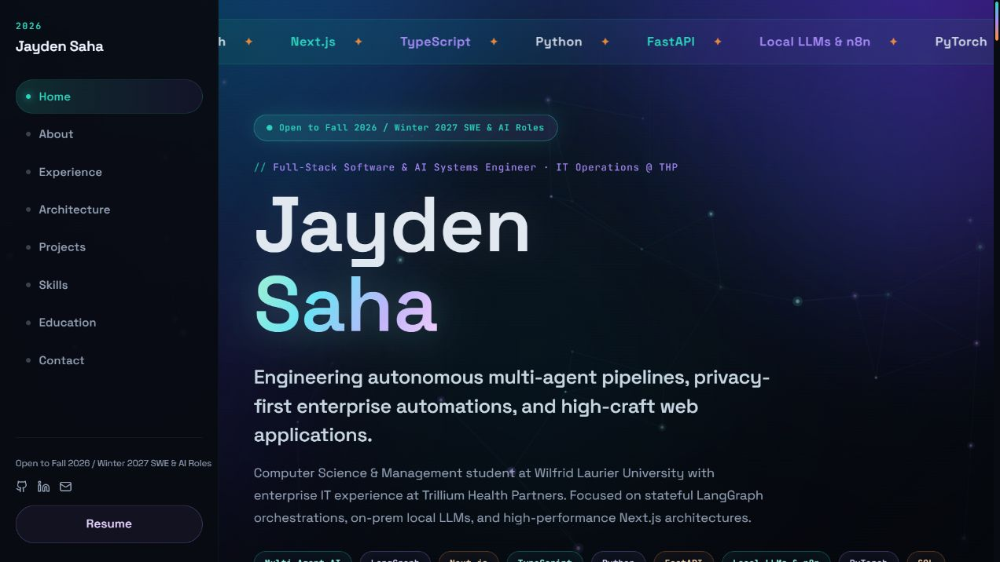
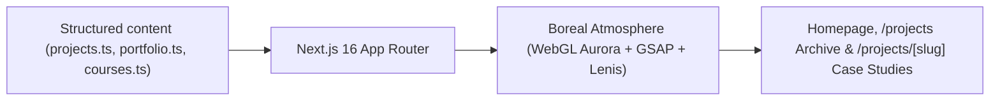

<div align="center">

# Jayden Saha — Personal Engineering Portfolio

**A home for software projects, AI systems case studies, and engineering experience.**

[](https://nextjs.org/)
[](https://react.dev/)
[](https://www.typescriptlang.org/)
[](https://tailwindcss.com/)
[](https://gsap.com/)
[](https://vercel.com/)

**[Open live project](https://jaydens-dev-portfolio.vercel.app/)**



<sub>Live portfolio homepage after the hero and typography finished rendering.</sub>

</div>

---

## Contents

- [Overview](#overview)
- [Key Capabilities](#key-capabilities)
- [Architecture](#architecture)
- [Tech Stack](#tech-stack)
- [Getting Started](#getting-started)
- [Verification](#verification)
- [Repository Layout](#repository-layout)

---

## Overview

Personal software engineering and AI systems portfolio built with **Next.js 16 (App Router)**, **React 19**, **TypeScript 5**, **Tailwind CSS v4**, **GSAP / ScrollTrigger**, **Lenis**, and **Vitest**. Designed around a Boreal Glassmorphism atmosphere with a live WebGL Aurora Veil & snow canvas, interactive parallax cabin horizon, filterable project archive, and deep-dive engineering case studies.

---

## Key Capabilities

- **Boreal Frost Atmosphere**: Single-rail icon navigation with an aurora-intensity slider (`SidebarNav`), WebGL Aurora Veil & snow canvas with blizzard-to-airy-snow scroll progression (`BorealBackdropCanvas.tsx`), and a 5-plane parallax Nordic cabin (`CabinHorizonSvg.tsx`).
- **Project Archive & Case Studies**: Flagship project showcase with captured screenshots and blueprint pipelines (`ProjectVisual`), filterable archive at `/projects`, and deep-dive pages at `/projects/[slug]` with sandboxed interactive demo embeds (`DemoModule`) and previous/next project navigation.
- **Experience & Education Timeline**: Scrubbed Experience timeline spine (`ExperienceList.tsx`), coursework showcase (`EducationSection.tsx`), and copyable contact actions.
- **Automated SEO & Metadata**: Dynamic `src/app/icon.tsx`, `src/app/opengraph-image.tsx`, `src/app/sitemap.ts`, `src/app/robots.ts`, and escaped JSON-LD structured data.
- **Security & Caching**: `Strict-Transport-Security`, `Content-Security-Policy`, `X-Frame-Options`, `X-Content-Type-Options`, `Referrer-Policy`, and `Permissions-Policy` configured in both `vercel.json` and `next.config.ts`, with `Cache-Control: public, max-age=0, must-revalidate` on PDF assets such as `/resume.pdf`.

---

## Architecture



---

## Tech Stack

| Layer | Technology |
| :--- | :--- |
| Framework | Next.js 16 (`App Router`, Server Components, `next/og`) |
| UI & Styling | React 19, Tailwind CSS v4 (`@tailwindcss/postcss`), `lucide-react`, `simple-icons` |
| Typography | Syne, Manrope, JetBrains Mono (`next/font/google`) |
| Motion & Graphics | GSAP + ScrollTrigger, Lenis, WebGL Aurora Veil & Snow Canvas |
| Testing & Quality | Vitest, TypeScript 5 (`tsc --noEmit`), ESLint 9 (`eslint-config-next`) |
| Deployment | Vercel (`vercel.json` + `next.config.ts` security headers) |

---

## Getting Started

### Prerequisites

- **Node.js**: `22.12+` (or `24+`)
- **npm**

### Local Development Setup

```bash
git clone https://github.com/ZenzerJs/portfolio.git
cd portfolio
npm install
npm run dev
```

Open [http://localhost:3000](http://localhost:3000) in your browser.

---

## Verification

| Command | Description |
| :--- | :--- |
| `npm run dev` | Start the local Next.js development server |
| `npm run build` | Build the production Next.js bundle |
| `npm run start` | Serve the production build locally |
| `npm run typecheck` | Run TypeScript type checking (`tsc --noEmit`) |
| `npm run lint` | Run ESLint across the repository |
| `npm test` | Run the Vitest test suite (`vitest run`) |

---

## Repository Layout

```text
portfolio/
├── .github/workflows/ci.yml   # GitHub Actions CI (typecheck, lint, test, build)
├── docs/images/               # Repository preview screenshot
├── public/
│   ├── projects/              # Captured project screenshots
│   └── resume.pdf             # Printable/downloadable resume
├── src/
│   ├── __tests__/             # Vitest unit & data-integrity tests
│   ├── app/                   # Next.js 16 App Router pages & metadata routes
│   │   ├── projects/          # Archive (/projects) and case studies (/projects/[slug])
│   │   ├── globals.css        # Tailwind v4 tokens & component styles
│   │   ├── icon.tsx           # Dynamic 32x32 PNG favicon
│   │   ├── layout.tsx         # Root shell & Syne / Manrope / JetBrains Mono fonts
│   │   ├── not-found.tsx      # 404 route
│   │   ├── opengraph-image.tsx# Dynamic 1200x630 Open Graph card
│   │   ├── page.tsx           # Portfolio homepage
│   │   ├── robots.ts          # Dynamic robots.txt
│   │   └── sitemap.ts         # Dynamic XML sitemap
│   ├── components/            # Modular React components (boreal, case-studies, education, experience, hero, layout, ui)
│   ├── content/               # Project metadata & case study entries (projects.ts)
│   ├── data/                  # Profile, experience, skills & coursework data
│   └── lib/                   # Site configuration and URL helpers
├── next.config.ts             # Next.js config & mirrored security headers
├── vercel.json                # Vercel deployment headers & cache rules
└── vitest.config.mts          # Vitest configuration with @/* path alias
```

<div align="center">

*Built by [@ZenzerJs](https://github.com/ZenzerJs)*

</div>
