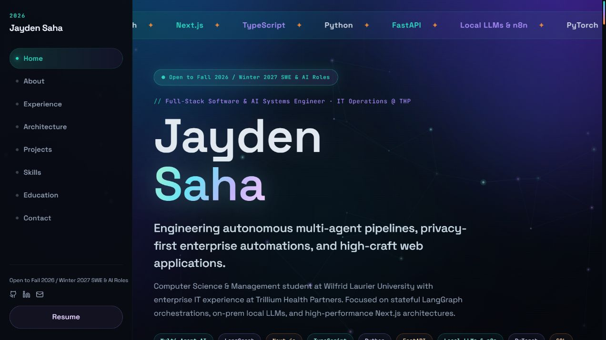
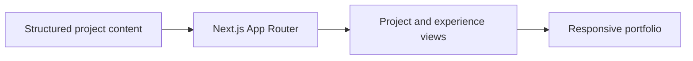

<div align="center">

# 🚀 Zenzer — Personal Engineering Portfolio

**A home for software projects, engineering case studies, and experience.**

[](https://nextjs.org/)
[](https://www.typescriptlang.org/)
[](https://tailwindcss.com/)
[](https://www.framer.com/motion/)
[](https://vercel.com/)

**[Open live project](https://jaydens-dev-portfolio.vercel.app/)**



<sub>Live portfolio homepage after the hero and typography finished rendering.</sub>

</div>

---

## 📋 Contents

- [Overview](#-overview)
- [Key Capabilities](#-key-capabilities)
- [Architecture](#-architecture)
- [Tech Stack](#-tech-stack)
- [Getting Started](#-getting-started)
- [Verification](#-verification)
- [Repository Layout](#-repository-layout)

---

## 💡 Overview

A personal software engineering portfolio built with Next.js 16 App Router, TypeScript, and fluid Framer Motion visual effects. Features interactive project showcases, interactive tech skill chips, custom WebGL/CSS Aurora backgrounds, and full SEO optimization.

---

## ✨ Key Capabilities

- **Fluid UI & Micro-Animations**: Built with Framer Motion primitives, including dynamic Aurora backgrounds (`Aurora.tsx`), blur-reveal text headers (`BlurRevealText.tsx`), magnetic hover buttons (`Magnetic.tsx`), and smooth scroll progress bars (`ScrollProgress.tsx`).
- **Interactive Project Showcase**: Browse featured engineering projects (`/projects`), filter by tech stack tags (`ProjectsFilter.tsx`), and explore deep-dive case study pages (`/projects/[slug]`).
- **Experience & Education Timeline**: Interactive career highlights, work experience cards (`ExperienceCard.tsx`), and academic course tracking (`courses.ts`).
- **Automated SEO & Metadata**: Dynamically generated Open Graph social images (`opengraph-image.tsx`), automatic sitemaps (`sitemap.ts`), and `robots.ts` search engine indexing configurations.
- **Responsive & Accessible**: Dark-themed responsive layout with accessible contrast standards and screen-reader optimizations.

---

## 🏗️ Architecture



---

## 🧱 Tech Stack

| Layer | Technology |
|---|---|
| Framework | next 16.1.6 |
| UI | react 19.2.3 |
| Motion | gsap ^3.15.0 |

---

## 🚀 Getting Started

### Prerequisites

- **Node.js**: `v18.0.0+`
- **npm** or **pnpm**

---

### Local Development Setup

1. **Clone the repository**:
   ```bash
   git clone https://github.com/ZenzerJs/portfolio.git
   cd portfolio
   ```

2. **Install dependencies**:
   ```bash
   npm install
   ```

3. **Run the development server**:
   ```bash
   npm run dev
   ```

4. **Open in Browser**:
   Navigate to [http://localhost:3000](http://localhost:3000).

---

## 🧪 Verification

| Command | Action |
| :--- | :--- |
| `npm run dev` | Starts local Next.js development server |
| `npm run build` | Compiles production build bundle |
| `npm run start` | Serves production build locally |
| `npm run lint` | Checks codebase against ESLint rules |

---

## 📁 Repository Layout

```text
portfolio/
├── public/                     # Static assets & downloadable resume PDF
├── src/
│   ├── app/                    # Next.js 16 App Router pages & metadata routes
│   │   ├── projects/           # Projects grid & dynamic [slug] detail pages
│   │   ├── layout.tsx          # Global site shell & font setup
│   │   ├── opengraph-image.tsx # Dynamic OG social image generator
│   │   ├── sitemap.ts          # Automatic XML sitemap route
│   │   └── page.tsx            # Main portfolio landing page
│   ├── components/             # Modular UI components
│   │   ├── about/              # AboutSection & bio components
│   │   ├── education/          # EducationSection & coursework
│   │   ├── experience/         # ExperienceCard & career timeline
│   │   ├── hero/               # Hero headline & call-to-action
│   │   ├── layout/             # SidebarNav, ContactSection, GradientBackground
│   │   └── ui/                 # Framer Motion primitives (Aurora, Magnetic, BlurReveal)
│   ├── content/                # Project case studies & showcase metadata (`projects.ts`)
│   ├── data/                   # Structured portfolio information (`portfolio.ts`, `courses.ts`)
│   └── lib/                    # Helper utilities & site constants (`site.ts`)
└── vercel.json                 # Vercel deployment configuration
```

<div align="center">

*Built by [@ZenzerJs](https://github.com/ZenzerJs)*

</div>
